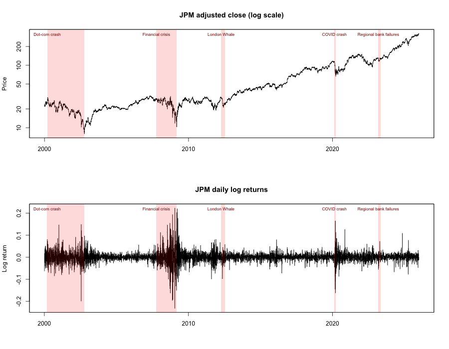
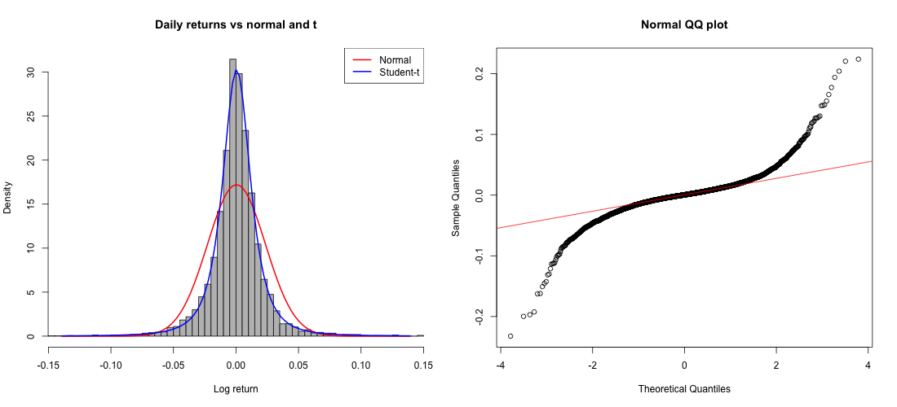
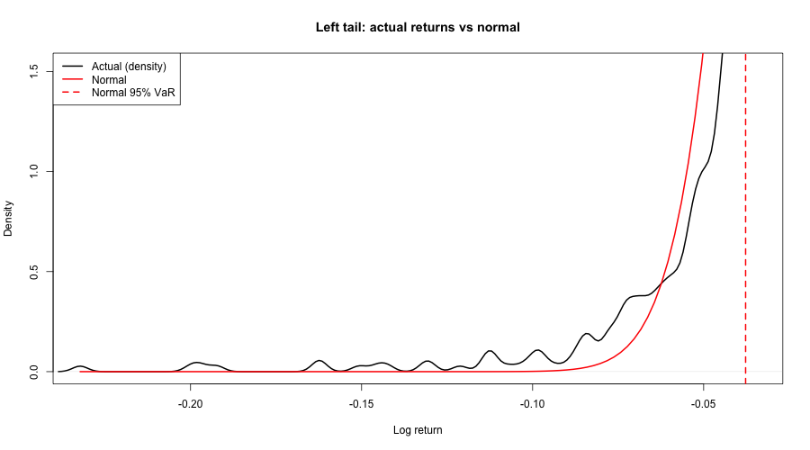
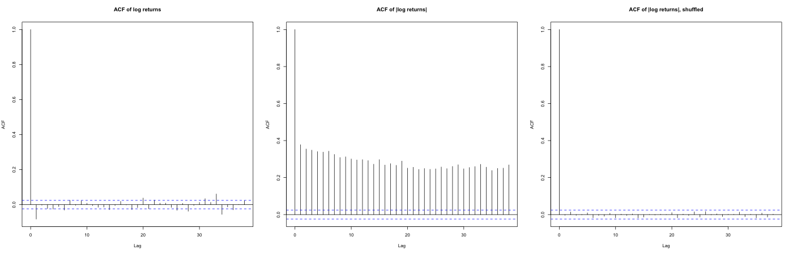
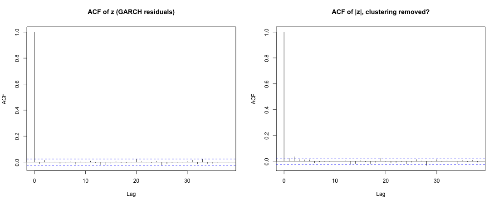
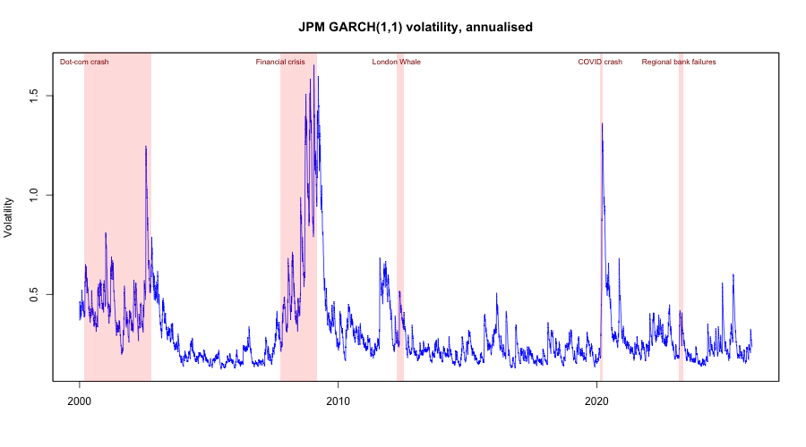
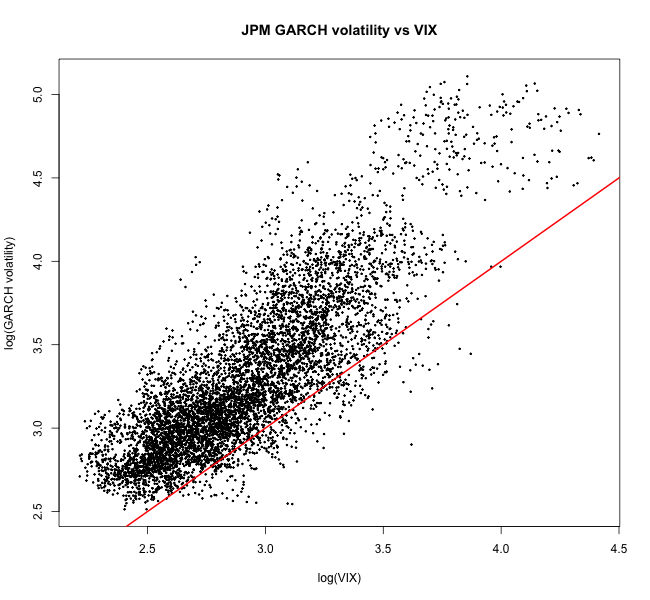
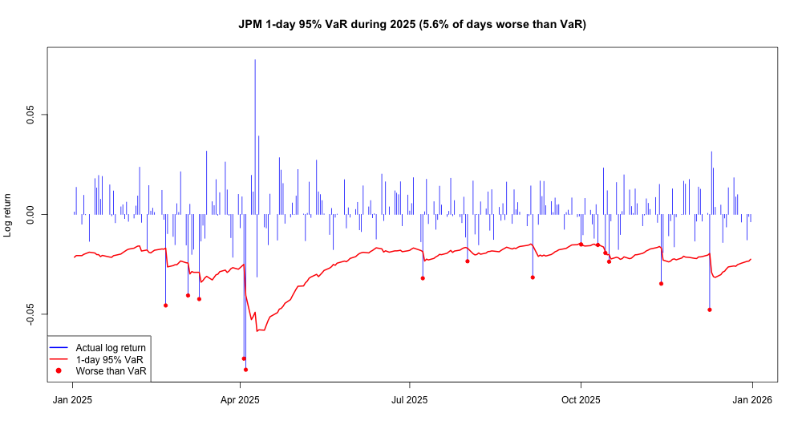

# Measuring Market Risk of JP Morgan Stock: VaR and Expected Shortfall in R

How much could you lose holding JP Morgan (JPM) shares on a bad day? This project
estimates daily **Value-at-Risk (VaR)** and **Expected Shortfall (ES)** for JPM from
2000 to 2025 using six methods, shows why the standard normal (bell curve) model
underestimates large losses, and backtests a GARCH model out of sample on 2025.



## Why this matters

Banks and funds use VaR and ES every day to set trading limits and decide how much
capital to hold. JP Morgan reports a daily VaR for its trading business in its annual
10-K filing. After 2008, the Basel Committee moved bank trading-risk rules from VaR to
Expected Shortfall, because VaR says nothing about how bad losses get once they pass
the VaR line. This project shows that problem on real data.

- **VaR (95%)**: the loss you should not exceed on 19 days out of 20.
- **ES (95%)**: the average loss on the worst 1 day in 20.

## Data

- JP Morgan daily adjusted close prices from Yahoo Finance, Jan 2000 to Dec 2025
  (about 6,500 trading days), downloaded with `quantmod`.
- Daily log returns. Covers the dot-com crash, 2008, COVID and the 2023 bank failures.

## Key findings

- **JPM returns are far from normal.** Kurtosis is 17.6 (normal = 3). There were 23 days
  with losses beyond 4 standard deviations, where a normal distribution predicts 0.2.
  The worst day was -10 standard deviations.
- **The normal model looks cautious on VaR but understates ES by 15-21%.** When losses go
  past VaR, they are much bigger than a normal distribution predicts.
- **The normal VaR fails when it matters most.** It was broken on 18.8% of days in the 2008
  crisis and 50% of days in the COVID crash, against 5% expected.
- **GARCH(1,1) with t errors explains most of the fat tails** (kurtosis falls from 17.6 to 6.3)
  and removes volatility clustering (lag-1 autocorrelation of absolute returns falls from
  0.38 to 0.03).
- **Out-of-sample test over 2025:** rolling GARCH-t VaR was broken on 14 days (5.6%) against
  12 expected, and passed both the Kupiec test (p = 0.67) and the Christoffersen test (p = 0.89).

## Results

### 1-day and 10-day VaR and ES (loss on a $1,000 position, 95%)

| Horizon | Method | VaR | ES | ES / VaR | VaR vs normal | ES vs normal |
|---|---|---|---|---|---|---|
| 1 day | Normal (formula) | 37.03 | 46.31 | 1.25 | 0% | 0% |
| 1 day | Normal (simulation) | 37.22 | 46.75 | 1.26 | 1% | 1% |
| 1 day | Historical simulation | 32.16 | 53.24 | 1.66 | -13% | 15% |
| 1 day | Student-t simulation | 30.27 | 56.19 | 1.86 | -18% | 21% |
| 1 day | GARCH(1,1)-t simulation | 21.58 | 31.12 | 1.44 | -42% | -33% |
| 10 days | Normal (formula) | 110.09 | 136.93 | 1.24 | 0% | 0% |
| 10 days | Student-t simulation | 109.94 | 169.13 | 1.54 | 0% | 24% |
| 10 days | Historical (10 random days) | 106.16 | 144.04 | 1.36 | -4% | 5% |
| 10 days | Historical (10 consecutive days) | 96.55 | 145.34 | 1.51 | -12% | 6% |

The GARCH figure is conditional on volatility at the end of 2025, which was a calm period.
The other methods use average risk over 2000-2025, including the crises.

### Normal distribution vs JPM

| Feature | Normal | JPM |
|---|---|---|
| Skewness | 0 | 0.21 |
| Kurtosis | 3 | 17.64 |
| Student-t degrees of freedom | infinite | 2.35 |
| Days within 1 sd | 68.3% | 82.1% |
| Days within 2 sd | 95.5% | 95.4% |
| Days with loss beyond 3 sd | 8.8 | 53 |
| Days with loss beyond 4 sd | 0.2 | 23 |
| Worst day (in sd) | -3.6 | -10.0 |
| ES / VaR at 95% | 1.25 | 1.66 |
| Autocorrelation of absolute returns (lag 1) | 0 | 0.38 |




### Volatility clustering and GARCH

| | Before GARCH | After GARCH (z) | Expected if model works |
|---|---|---|---|
| Kurtosis | 17.64 | 6.27 | 7.27 |
| Autocorrelation (lag 1) | -0.083 | -0.012 | 0 |
| Autocorrelation of absolute value (lag 1) | 0.379 | 0.025 | 0 |
| Skewness | 0.21 | -0.13 | 0 |

Fitted GARCH(1,1)-t parameters: alpha1 = 0.087, beta1 = 0.909, t degrees of freedom = 5.4.
Persistence (alpha1 + beta1) is 0.996, so a volatility shock takes about 165 trading days
(roughly 8 months) to fade by half.





GARCH volatility has a correlation of 0.82 with the VIX. JPM's volatility is usually above the
VIX, because a single bank stock is riskier than the whole S&P 500.



### Crises

If the normal model were right, about 5% of days in any period would be worse than its VaR.

| Crisis | Period | Worst day | Peak GARCH volatility | Days worse than normal VaR |
|---|---|---|---|---|
| Dot-com crash | Mar 2000 - Oct 2002 | -18.1% | 125% | 8.8% |
| Financial crisis | Oct 2007 - Mar 2009 | -20.7% | 166% | 18.8% |
| London Whale | Apr 2012 - Jul 2012 | -9.3% | 52% | 4.4% |
| COVID crash | Feb 2020 - Mar 2020 | -15.0% | 136% | 50.0% |
| Regional bank failures | Mar 2023 - May 2023 | -5.4% | 42% | 7.9% |

London Whale was JP Morgan's own $6bn trading loss in 2012, partly hidden by a change to
its VaR model. The share price barely reacted compared with the market crashes.

### Backtest: rolling 1-day VaR in 2025

GARCH was re-estimated every day of 2025 using only data up to the day before, then used
to forecast that day's VaR.

| | Result |
|---|---|
| Days in 2025 | about 250 |
| Expected breaches (5%) | 12 |
| Actual breaches | 14 (5.6%) |
| Kupiec test, right number of breaches | p = 0.67, pass |
| Christoffersen test, breaches not clustered | p = 0.89, pass |

The model reacts quickly after shocks (see April 2025, the tariff sell-off) but cannot
foresee the first day of a shock.



## Methods

| Method | Idea |
|---|---|
| Normal | VaR and ES from the bell curve formula, checked by simulation |
| Historical simulation | Resample 100,000 days from JPM's actual returns |
| Student-t | Fit a fat-tailed t distribution, then simulate |
| 10-day simulations | Sum 10 t draws, 10 random past days, or 10 consecutive past days |
| GARCH(1,1)-t | Volatility that changes every day, with fat-tailed errors |
| Backtest | Rolling daily GARCH forecasts for 2025, Kupiec and Christoffersen tests |

## How to run

```r
install.packages(c("quantmod", "moments", "metRology", "rugarch"))
```

Then run `var_es_analysis.R` in RStudio (or `Rscript var_es_analysis.R`). It downloads
the data, saves charts to `plots/` and tables to `results/`. The 2025 backtest takes a
few minutes. To analyse another stock, change `ticker` at the top of the script.

## Limitations

- One stock only; a portfolio would also need correlations between assets.
- Based on past data, so it cannot foresee a new type of crisis.
- GARCH reacts after a shock, not before it.
- Only VaR is backtested, not ES.
- Symmetric GARCH; GJR-GARCH or a skewed t distribution could capture the fact that falls
  raise volatility more than rises.

## Acknowledgements

Built on exercises from the Duke University course *Financial Risk Management with R*
(Coursera), extended with JP Morgan data, crisis analysis, comparison tables and the 2025
out-of-sample backtest.
